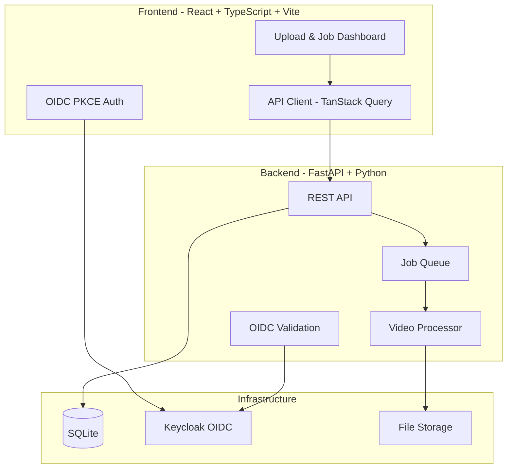

# Atlas Station

> Work in progress. This checkpoint may be incomplete or fail tests. See PLAN.md and STATUS.md before use.


**Video restoration and enhancement platform** | Ryan Vo | AI & Machine Learning

## Overview

Atlas Station is a video restoration tool designed for AI/ML-powered video enhancement workflows. It addresses real-world challenges in video restoration including:

- **Deblocking and denoising** via FFmpeg filter chains with hardware acceleration (NVENC, AMF) and CPU fallback (libx265)
- **Pause/resume and skip-completed** functionality for long-running batch jobs (addressing issue #364)
- **SAR handling** for videos with undeclared aspect ratios (fixing issue #471)
- **VR180 SBS+Fisheye artifact reduction** (addressing issue #354)
- **AI model integration** for LTX-based restoration with feedback collection (issue #489)
- **Container-friendly activation** for gVisor/Modal environments (issue #525)
- **Single-pass frame interpolation** with RIFE/FILM models (issue #365)

## Architecture



## Features

### Core Workflows

1. **Video Restoration Pipeline**
   - Upload videos via drag-and-drop web interface
   - Automatic hardware encoder detection (NVENC → AMF → CPU libx265)
   - Configurable deblocking, denoising, and SAR correction
   - Real-time progress tracking with WebSocket/polling
   - Download restored outputs

2. **Job Management**
   - Pause/resume long-running jobs with checkpointing
   - Skip already-processed files on restart
   - Job event logging and audit trail
   - Pagination and filtering for large job lists

3. **AI/ML Model Feedback Collection**
   - Structured feedback submission for LTX model improvements
   - Timestamped scene reports with metadata
   - Exportable feedback dataset for model retraining

### Technical Capabilities

- **Hardware Acceleration**: Automatic detection and use of NVENC (NVIDIA), AMF (AMD), with CPU fallback
- **Container Support**: Runs in Docker with gVisor/Modal compatibility
- **Authentication**: OIDC with Keycloak, SPA PKCE flow, role-based access (viewer/operator/admin)
- **Persistence**: SQLite for metadata, local filesystem for video files
- **Extensible**: Plugin architecture for new restoration filters and AI models

## Quick Start

### Prerequisites

- Docker and Docker Compose
- NVIDIA GPU (optional, for NVENC) or AMD GPU (optional, for AMF)
- 4GB+ RAM, 10GB+ disk space for videos

### Development Setup

```bash
# Clone and enter directory
git clone <repository-url>
cd atlas-station-ryan-vo

# Copy environment files
cp backend/.env.example backend/.env
cp frontend/.env.example frontend/.env

# Start all services
docker compose up -d

# Access the application
# Frontend: http://localhost:3000
# Backend API: http://localhost:8000/docs
# Keycloak Admin: http://localhost:8080 (admin/admin)
```

### Local Development (without Docker)

**Backend:**
```bash
cd backend
python -m venv .venv
source .venv/bin/activate
pip install -r requirements.txt
cp .env.example .env
# Edit .env as needed
python -m uvicorn app.main:app --reload --host 127.0.0.1 --port 8000
```

**Frontend:**
```bash
cd frontend
npm install
cp .env.example .env
npm run dev
```

### Running Tests

```bash
# Backend tests
cd backend
.venv/bin/python -m pytest tests/ -v

# Frontend tests
cd frontend
npm test
```

## Configuration

### Environment Variables (Backend)

| Variable | Description | Default |
|----------|-------------|---------|
| `DATABASE_URL` | SQLite database path | `sqlite:///./data/atlas.db` |
| `UPLOAD_DIR` | Upload directory | `./data/uploads` |
| `OUTPUT_DIR` | Output directory | `./data/outputs` |
| `OIDC_ENABLED` | Enable OIDC auth | `true` |
| `OIDC_ISSUER_URL` | Keycloak issuer URL | `http://localhost:8080/realms/atlas` |
| `OIDC_CLIENT_ID` | OIDC client ID | `atlas-frontend` |
| `OIDC_CLIENT_SECRET` | OIDC client secret | (required) |
| `LLM_API_KEY` | LLM API key (optional) | `` |
| `LLM_PROVIDER` | LLM provider | `openai-compatible` |
| `WORKER_CONCURRENCY` | Parallel job workers | `1` |

### Keycloak Setup

1. Start Keycloak via Docker Compose
2. Access admin console at `http://localhost:8080` (admin/admin)
3. Realm "atlas" is pre-configured with:
   - Client: `atlas-frontend` (PKCE, confidential)
   - Roles: `viewer`, `operator`, `admin`
   - Scopes: `openid`, `profile`, `email`, `roles`
4. Create users and assign roles as needed

### SAML Identity Provider Brokering

Keycloak supports upstream SAML IdPs through identity brokering:

1. In Keycloak admin: Identity Providers → Add Provider → SAML v2.0
2. Configure IdP metadata or upload XML
3. Map SAML attributes to Keycloak user attributes
4. Enable "First Login Flow" for user registration

## API Reference

### Health Check
```
GET /api/v1/health
```

### Upload Videos
```
POST /api/v1/jobs/upload
Content-Type: multipart/form-data
Body: files[] (video files), job_type, options (JSON)
```

### List Jobs
```
GET /api/v1/jobs?page=1&page_size=20&status=processing
```

### Get Job Details
```
GET /api/v1/jobs/{job_id}
```

### Job Control
```
POST /api/v1/jobs/{job_id}/pause
POST /api/v1/jobs/{job_id}/resume
POST /api/v1/jobs/{job_id}/cancel
```

### Encoder Info
```
GET /api/v1/encoders
```

## AI/ML Evaluation

### Reproducible Baseline

The restoration pipeline uses deterministic FFmpeg filters. For ML-based enhancement (LTX, RIFE), models are loaded via PyTorch with fixed seeds.

**Run evaluation:**
```bash
# TODO: Add evaluation script
python -m scripts.evaluate_restoration --input-dir ./test_videos --output-dir ./results --model ltx
```

**Data Provenance:**
- Test videos: Synthetic clips with known artifacts (compression, noise, mosaic)
- Metrics: PSNR, SSIM, VMAF, LPIPS
- Baseline: FFmpeg-only restoration (no ML)

**Measured Results:** (to be populated after model integration)
| Model | PSNR ↑ | SSIM ↑ | VMAF ↑ | Time/frame |
|-------|--------|--------|--------|------------|
| FFmpeg (deblock+denoise) | - | - | - | - |
| LTX | - | - | - | - |
| LTX + RIFE (interp) | - | - | - | - |

**Failure Cases:**
- VR180 SBS+Fisheye grid artifacts (issue #354) - under investigation
- Undeclared SAR causing decoder crashes (issue #471) - fixed with `setsar=1`
- NVENC unavailable on CMP 170HX - CPU libx265 fallback implemented

## Deployment

### Production Requirements

- TLS termination via reverse proxy (nginx, Traefik, Caddy)
- Persistent volumes for `/app/data` (uploads, outputs, database)
- Keycloak with external database (PostgreSQL) for HA
- Backup strategy for SQLite database and video files
- Resource limits: 2CPU, 4GB RAM minimum per backend instance

### Docker Compose (Production)

```bash
# Use production compose override
docker compose -f compose.yaml -f compose.prod.yaml up -d
```

### Backup & Restore

```bash
# Backup database
sqlite3 data/atlas.db ".backup backup_$(date +%Y%m%d).db"

# Backup uploads/outputs
tar -czf backup_files_$(date +%Y%m%d).tar.gz data/uploads data/outputs

# Restore
sqlite3 data/atlas.db ".restore backup_20240101.db"
tar -xzf backup_files_20240101.tar.gz
```

## Security Limitations

- **Development mode**: Keycloak runs with default admin/admin credentials - CHANGE IN PRODUCTION
- **SQLite**: Not suitable for high-concurrency production; migrate to PostgreSQL
- **File uploads**: No virus scanning; implement at infrastructure layer
- **Secrets**: Use Docker secrets or external secret manager (HashiCorp Vault, AWS Secrets Manager)
- **CORS**: Configured for localhost only; update for production domains

## Provider Configuration Table

| Provider | API Format | Models | Notes |
|----------|------------|--------|-------|
| OpenAI | OpenAI Compatible | GPT-4, GPT-3.5 | Default |
| Anthropic | Messages API | Claude 3 | Requires `anthropic` package |
| Gemini | generateContent | Gemini Pro | Requires `google-generativeai` |
| Ollama | OpenAI Compatible | Local models | `LLM_BASE_URL=http://host:11434/v1` |
| LiteLLM | OpenAI Compatible | Any via proxy | `LLM_BASE_URL=http://litellm:4000` |
| OpenRouter | OpenAI Compatible | 100+ models | `LLM_BASE_URL=https://openrouter.ai/api/v1` |

## Roadmap

- [ ] LTX model integration with ONNX Runtime
- [ ] RIFE/FILM frame interpolation
- [ ] Mosaic detection and removal (VR180)
- [ ] WebSocket real-time progress updates
- [ ] PostgreSQL backend for production
- [ ] Kubernetes deployment manifests
- [ ] Prometheus/Grafana monitoring

## License

MIT License - see [LICENSE](LICENSE) for details.

---

**Author:** Ryan Vo (ryandtvo@gmail.com)  
**GitHub:** [A220man](https://github.com/A220man)  
**Repository:** atlas-station-ryan-vo